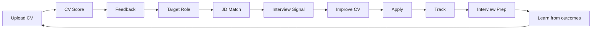

# CareerSignal — UI/UX Design Specification

**Tagline:** Build your CV. Match any job. Know your interview signal.

**Positioning:** AI career operating system — not a job board.

---

## 1. Product design summary

CareerSignal guides candidates through a repeated improvement loop:

**Core user question:** *Where should I apply today, and what should I fix before applying?*

---

## 2. Brand and visual identity

| Token | Value | Usage |
|-------|-------|--------|
| Primary | Indigo `#4F46E5` | CTAs, links, active nav |
| Navy | Slate `#0F172A` | Headings |
| Success | Emerald `#059669` | Strong signal, high match |
| Warning | Amber `#D97706` | Moderate gaps |
| Risk | Rose `#E11D48` | Low signal only |
| Background | `#F8FAFC` | Page bg |
| Surface | `#FFFFFF` | Cards |
| Border | `#E2E8F0` | Dividers |

**Typography:** Inter, system-ui fallback. Hero 36–48px, section 24px, body 16px.

**Mood:** Linear × Notion × LinkedIn Jobs — calm, premium, credible.

**Avoid:** Job-portal clutter, cheap gradients, guaranteed-interview hype.

---

## 3. Design principles

1. **Clarity over clutter** — career status visible in 5 seconds
2. **Explainability over black-box AI** — every score has why + next action
3. **Confidence over anxiety** — guided, not judged
4. **Action over information overload** — one primary CTA per section
5. **Premium trust** — verified badges, salary transparency
6. **Career command center** — dashboard-first, not listing-first
7. **Mobile-first** — sticky CTAs, collapsible panels, bottom sheets

---

## 4. Information architecture

### Public
`/`, `/product`, `/jobs`, `/resume-score`, `/jd-match`, `/for-employers`, `/pricing`, `/login`, `/register`, `/university`

### Candidate app
`/dashboard`, `/resume-score`, `/jd-match`, `/jobs`, `/applications`, `/interview-prep`, `/career-coach`, `/cv-builder`, `/profile`, `/recommended`

### Recruiter
`/recruiter`, `/recruiter/dashboard`, `/recruiter/jobs`, `/recruiter/messages`, `/recruiter/company`, `/recruiter/billing`

### Admin
`/admin`, `/admin/companies`, `/admin/jobs`, `/admin/alerts`, `/admin/analytics`

---

## 5. Journey maps

### Candidate onboarding
Welcome → CV upload → Roles → Market → Preferences → Analyzing → Results → Recommended

### Recruiter
Landing → Sign up → Post job → AI JD score → Review applicants → Shortlist → Message

### Admin
Trust dashboard → Verify company → Moderate job → Resolve report → Analytics

---

## 6–19. Page specifications

See implementation in `apps/web/src/app/*`. Key layouts:

- **Homepage:** Hero with dashboard preview, 8 sections, trust wall
- **Dashboard:** 6 metric cards, next actions, probability map, pipeline snapshot
- **CV Score:** 8-dimension rings, section feedback, bullet rewrite
- **JD Match:** Two-column paste + results, breakdown, missing keywords
- **Jobs:** Smart tabs, extended filters, personalized cards
- **Job detail:** Sticky match panel, explainability, apply flow
- **Applications:** Board/table/analytics views, extended pipeline
- **Interview prep:** Question bank, STAR builder, company summary
- **Career coach:** Chat + suggested prompts + action buttons
- **Recruiter/Admin:** Dashboards per plan Phase 6–7

---

## 10. Design tokens (CSS)

Defined in `apps/web/src/app/globals.css` — semantic colors, radius, shadows, signal bands.

---

## 11. Microcopy

- Use **Interview Signal**, not guaranteed interview
- Pair scores with: what it means, why it matters, what to do next
- Example: *"JD Match 82/100 — strong alignment; add B2B SaaS keywords where truthful to improve signal."*

---

## 12. Responsive rules

- Desktop: sidebar + sticky match panel
- Tablet: collapsible sidebar
- Mobile: bottom nav, horizontal pipeline scroll, filter bottom sheet

---

## 13. Accessibility

- WCAG AA contrast on text
- Focus rings on interactive elements
- Score labels for screen readers (not color-only)
- Min 44px tap targets on mobile

---

## 14. MVP sprint matrix

| Sprint | Scope |
|--------|--------|
| S1 | Design docs, tokens, UI primitives, app shell |
| S2 | Homepage, pricing, onboarding v2 |
| S3 | Dashboard, CV Score, JD Match polish |
| S4 | Job search v2, job detail |
| S5 | Application tracker |
| S6 | Interview prep, career coach |
| S7 | CV Builder v1 |
| S8 | Recruiter app |
| S9 | Admin trust |
| S10 | Polish, university stub |

---

## 15. Demo persona

**Rajeev Kumar** — 13y exp, target AI Product Manager, markets DE/AE/ES/Remote EU, CV Score 78. Use sparingly in demos.
